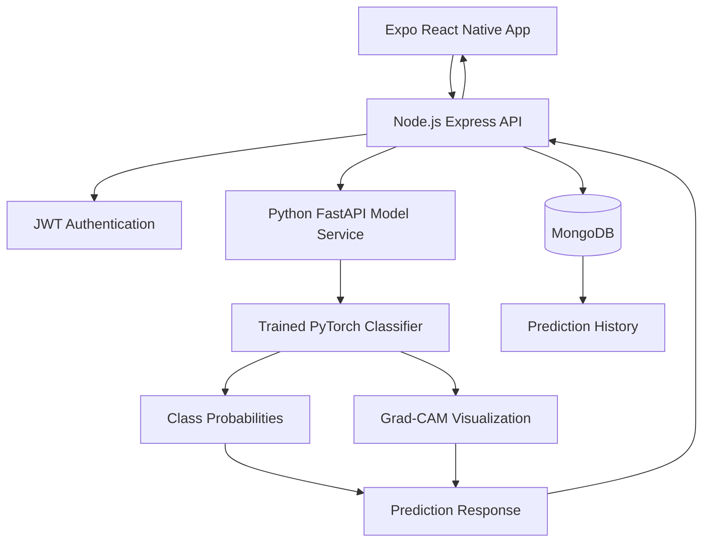

# 🧠 NeuroScope — Brain MRI Classification with Explainable AI

**NeuroScope** is an educational brain MRI classification application that combines deep learning and Explainable Artificial Intelligence (XAI) to classify MRI images into four dataset categories: glioma, meningioma, no tumor, and pituitary tumor.

The application integrates trained image classification models, Grad-CAM visualizations, a Python inference service, a Node.js REST API, and an Expo React Native mobile application. It provides model predictions, class probabilities, visual explanations, and secure prediction history management.

> **Important:** NeuroScope is an academic research and educational project, not a medical device. Its predictions and visualizations are not clinical diagnoses and must not be used to make medical or treatment decisions.

---

## ✨ Features

- **Brain MRI Classification:** Classifies uploaded MRI images into four dataset categories.
- **Deep Learning Inference:** Uses trained PyTorch image classifiers for model predictions.
- **Explainable AI:** Generates Grad-CAM heatmaps to visualize image regions influencing a prediction.
- **Class Probabilities:** Displays the model's probability scores for all four categories.
- **Mobile Application:** Provides an interface built with Expo and React Native.
- **User Authentication:** Supports account registration and login using JWT-based authentication.
- **Prediction History:** Saves previous predictions for authenticated users.
- **Image Management:** Stores uploaded MRI images and generated Grad-CAM visualizations alongside prediction records.
- **REST API:** Connects the mobile application, backend API, and model inference service.
- **Cloud Deployment:** Supports separate backend services using Render and a MongoDB database.

## 🖥️ Application Preview

_Add screenshots of your application here._

Suggested screenshots:

- Home screen
- MRI image selection
- Classification results and class probabilities
- Grad-CAM visualization
- Prediction history
- Login and registration screens

Example layout:

| Home Screen | Prediction Results |
|---|---|
| Add `screenshots/home.png` | Add `screenshots/results.png` |

| Grad-CAM Explanation | Prediction History |
|---|---|
| Add `screenshots/gradcam.png` | Add `screenshots/history.png` |

Create a `screenshots` directory in the repository and replace these placeholders with actual application screenshots.

## 🏗️ System Architecture

NeuroScope uses a three-part architecture consisting of a mobile frontend, a Node.js backend, and a Python machine learning inference service.



### Technology Stack

| Component | Technology |
|---|---|
| Mobile frontend | React Native, Expo |
| Backend API | Node.js, Express.js |
| Machine learning API | Python, FastAPI |
| Deep learning | PyTorch |
| Explainable AI | Grad-CAM |
| Database | MongoDB |
| Authentication | JSON Web Tokens (JWT) |
| Deployment | Render |
| Development language | JavaScript and Python |

## 🧠 Classification Categories

The classifier returns one of four labels in the following order:

| Class Index | Dataset Label | Description |
|---|---|---|
| 0 | `glioma` | Glioma category in the training dataset |
| 1 | `meningioma` | Meningioma category in the training dataset |
| 2 | `notumor` | No-tumor category in the training dataset |
| 3 | `pituitary` | Pituitary tumor category in the training dataset |

The output represents the model's classification of an input image, not a confirmed medical condition.

## 🔍 Explainable AI with Grad-CAM

NeuroScope incorporates Gradient-weighted Class Activation Mapping (Grad-CAM) to provide a visual explanation of a model's prediction.

Grad-CAM produces a heatmap that highlights image regions contributing to the selected class score. The heatmap is overlaid on the original MRI image to make the model's behavior easier to inspect.

The application presents:

- The predicted dataset label
- Probability scores for all four classes
- A Grad-CAM visualization for the selected model prediction
- Saved prediction results for later review

**Limitation:** A Grad-CAM heatmap does not establish that a highlighted region contains a tumor or that the model's prediction is medically correct.

## 📱 Application Workflow

1. Register for an account or sign in.
2. Select an MRI image in a supported format.
3. Submit the image to the Node.js backend.
4. The backend validates the upload and forwards it to the Python inference service.
5. The model preprocesses the image and generates class probabilities.
6. Grad-CAM generates a visualization for the selected prediction.
7. The backend stores the prediction record and associated images in MongoDB.
8. The mobile application displays the result and allows the user to access saved prediction history.

## 📂 Project Structure

```text
NeuroScope/
├── backend/
│   ├── model_api/
│   │   └── main.py
│   │
│   └── node-api/
│       ├── src/
│       ├── .env.example
│       └── package.json
│
├── mobile/
│   ├── .env.example
│   └── package.json
│
├── outputs/
│   ├── checkpoints/
│   └── reports/
│       └── experiment_summary.csv
│
├── requirements-app-api.txt
├── render.yaml
└── README.md
```

*Note: This is a representative overview of the repository structure. Additional files and directories may exist in your implementation.*

## ⚙️ Prerequisites

Install the following before running the application:

- Python 3.10 or another version supported by the project's dependencies
- Node.js and npm
- MongoDB locally or a MongoDB Atlas database
- Git
- Expo-compatible development environment
- A trained model checkpoint
- Sufficient RAM for PyTorch model loading and inference

Use the Python version and dependency versions specified by your project configuration where available.

## 🚀 Getting Started

### 1. Clone the Repository

```bash
git clone <YOUR_GITHUB_REPOSITORY_URL>
cd NeuroScope
```

Replace `<YOUR_GITHUB_REPOSITORY_URL>` with your repository's actual Git URL.

### 2. Start the Python Model API

Install the inference service dependencies from the repository root:

```bash
pip install -r requirements-app-api.txt
```

Set the path to the trained checkpoint in PowerShell:

```powershell
$env:MODEL_CHECKPOINT_PATH = "outputs/checkpoints/best_swin_tiny_patch4_window7_224.pth"
```

Start the FastAPI server:

```bash
uvicorn backend.model_api.main:app --reload --port 8000
```

The inference service should be accessible at:

- Health check: `http://localhost:8000/health`
- Interactive API documentation: `http://localhost:8000/docs`

The model service reports `ready: false` when its required checkpoint is unavailable or the model is not ready.

**Important:** The checkpoint must match the architecture and configuration expected by the inference code. The checkpoint file is not necessarily included in the Git repository.

### 3. Configure the Node.js Backend

Open a new terminal:

```bash
cd backend/node-api
npm install
```

Create a `.env` file using `.env.example` as a reference.

Example configuration:

```dotenv
PORT=4000
MONGODB_URI=mongodb://127.0.0.1:27017/neuroscope
JWT_SECRET=replace_with_a_long_random_secret
MODEL_API_URL=http://127.0.0.1:8000
```

Adjust the variable names to match your actual `.env.example` and backend implementation.

Start the API:

```bash
npm run dev
```

The Node.js backend should be available at `http://localhost:4000`.

### 4. Configure the Mobile Application

Open another terminal:

```bash
cd mobile
npm install
```

Create a `.env` file based on `mobile/.env.example`.

Configure the API address:

```dotenv
EXPO_PUBLIC_API_URL=http://YOUR_COMPUTER_LAN_IP:4000
```

Replace `YOUR_COMPUTER_LAN_IP` with your development machine's local network IP address.

Start Expo:

```bash
npm start
```

Follow the Expo CLI instructions to open the application in an emulator or on a compatible mobile device.

**Networking note:** When using a physical phone, `localhost` refers to the phone itself. Your phone and development machine should be able to communicate over the network, and the required ports must be reachable.

## 🔌 API Documentation

The Node.js backend exposes REST endpoints for authentication and prediction management.

### Health Checks

| Method | Endpoint | Purpose |
|---|---|---|
| GET | `/health` | Check Node API health and readiness |
| GET | `/health` on the Python service | Check model service and checkpoint readiness |

The health response fields depend on the implementation. Check both services before testing predictions.

### Authentication

| Method | Endpoint | Purpose |
|---|---|---|
| POST | `/api/v1/auth/register` | Register a user |
| POST | `/api/v1/auth/login` | Authenticate a user and obtain a bearer token |

### Predictions

| Method | Endpoint | Purpose |
|---|---|---|
| POST | `/api/v1/predictions` | Submit an MRI image for classification |
| GET | `/api/v1/predictions?limit=20` | Retrieve recent prediction metadata |
| GET | `/api/v1/predictions/:id` | Retrieve a saved prediction and its images |
| DELETE | `/api/v1/predictions/:id` | Delete a saved prediction |

Prediction endpoints require a valid bearer token.

### Submit an MRI Image

The prediction endpoint accepts a multipart form upload with the field name `image`.

Supported formats:

- JPEG
- PNG
- WebP

Example request:

```bash
curl -X POST http://localhost:4000/api/v1/predictions \
  -H "Authorization: Bearer YOUR_ACCESS_TOKEN" \
  -F "image=@sample_mri.jpg"
```

Replace `YOUR_ACCESS_TOKEN` with the token returned by the login endpoint and `sample_mri.jpg` with a suitable test image.

The backend enforces an upload limit of 8 MB.

### Example Prediction Response

The following is an illustrative response structure, not a guarantee of the exact JSON returned by the implementation.

```json
{
  "prediction": {
    "label": "glioma",
    "probabilities": {
      "glioma": 0.72,
      "meningioma": 0.12,
      "notumor": 0.08,
      "pituitary": 0.08
    }
  },
  "gradcam": "<generated visualization>"
}
```

The values above are examples only and do not represent measured model performance or a real patient's result. Refer to the implementation for the actual response schema.

## ☁️ Deployment on Render

The repository includes a `render.yaml` configuration for deploying the Python inference service and Node.js API as separate web services.

### Python Inference Service

Configure the following environment variables:

| Variable | Purpose |
|---|---|
| `MODEL_CHECKPOINT_URL` | Reachable URL from which the model checkpoint can be downloaded |
| `MODEL_NAME` | Model architecture identifier; defaults to `swin_tiny_patch4_window7_224` |

Ensure the checkpoint download is accessible to the service and the service has enough memory to load the model and process requests.

### Node.js API Service

Configure:

| Variable | Purpose |
|---|---|
| `MONGODB_URI` | MongoDB connection string |
| `MODEL_API_URL` | URL of the deployed Python inference service |
| `JWT_SECRET` | Long, randomly generated authentication secret |

Use the actual environment variable names required by your source code and deployment configuration.

### Mobile Application

Set `EXPO_PUBLIC_API_URL` to the deployed Node.js API URL before creating the production application build with your chosen Expo/EAS workflow.

After deployment, verify the health endpoints, authentication, prediction upload, history retrieval, and deletion behavior.

## 📊 Model Evaluation and Research

NeuroScope is designed to support academic experimentation with brain MRI image classifiers and explainable AI.

The repository includes:

```text
outputs/reports/experiment_summary.csv
```

This file contains the original experiment metrics recorded by the project.

When documenting model performance, report the evaluation dataset, train/test split, preprocessing pipeline, metrics, and model configuration. Include per-class precision, recall, F1-score, and a confusion matrix where available.

**Research disclaimer:** Experimental accuracy and other dataset metrics do not establish clinical validity, safety, or generalization to real-world patient populations. The model requires appropriate independent validation before any clinical use could be considered.

## 🔐 Security and Privacy

NeuroScope processes potentially sensitive medical images. Use appropriate safeguards when developing, testing, and deploying the application.

- Never commit `.env` files, JWT secrets, database credentials, or private access tokens.
- Keep trained checkpoints and other large artifacts out of Git when they are intentionally excluded from version control.
- Configure MongoDB authentication, access controls, network restrictions, and backups appropriately.
- Enforce authentication and per-user authorization for prediction history operations.
- Use HTTPS for production API communication.
- Establish suitable retention and deletion policies for uploaded images and generated visualizations.
- Avoid uploading identifiable patient information to unapproved services.
- Test authorization to ensure users cannot retrieve or delete another user's records.

A successful upload or prediction does not imply that the image has been processed in a clinically secure or validated workflow.

## ⚠️ Limitations

- The model recognizes patterns learned from its training dataset.
- Predictions can be incorrect, including when an image resembles a class in the training data.
- Class probabilities are model outputs and should not automatically be interpreted as calibrated clinical confidence.
- Grad-CAM is an explanatory visualization, not proof of medical relevance.
- Performance can vary with scanner characteristics, image quality, preprocessing, and differences in patient populations.
- Model evaluation results are experimental and do not establish clinical effectiveness.
- NeuroScope is intended for education and research, not diagnosis, screening, treatment selection, or emergency medical decisions.

If you have concerns about an MRI result, consult a qualified medical professional.

## 🛣️ Future Improvements

Potential extensions for future research and development include:

- Comparative evaluation of ConvNeXt, EfficientNetV2, and Swin Transformer architectures.
- More comprehensive per-class evaluation and error analysis.
- Improved calibration and uncertainty estimation.
- Additional explainability techniques alongside Grad-CAM.
- Independent testing on appropriately authorized external datasets.
- Automated testing for authentication, upload validation, and API integration.
- Improved model artifact versioning and deployment monitoring.
- Enhanced mobile accessibility and prediction history management.

These are potential future improvements, not claims that every feature is currently implemented.

## 🎓 Academic Project

NeuroScope is developed as an academic major project focused on deep learning, brain MRI image classification, mobile application development, backend engineering, and Explainable Artificial Intelligence.

The project explores how machine learning predictions and visual explanations can be integrated into a complete software application while acknowledging the limitations of dataset-based medical image classification.

## 📄 License


## 👨‍💻 Author

**Developed as an academic major project.**
**By Nishan Bhattarai and team**
---

*NeuroScope — Exploring brain MRI classification through deep learning and explainable AI.*